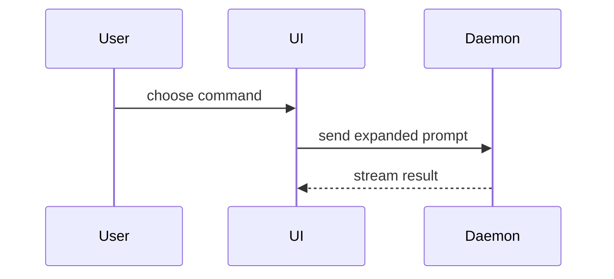

编写 PR 正文用这个模板：

```markdown
## Summary

<diagram, diff-sketch, or tree>

## Evidence

- **Before:** <screenshot/output/failing test run>
  **After:** <screenshot/output/passing test run>

## Merge Danger

**Door:** <one-way or two-way>

<optional: description>

**Blast Radius:** <one-word description>

<optional: potential ramifications of merge>
```

## 各小节

跳过所有开场铺垫，正文从简。使用用户 `GLOSSARY.md` 里的领域语言。

### 摘要

挑最小的视图，只要能把关键点说清楚就行。

- 逻辑或算法用伪代码展示：

```text
on(save)
  if content is unchanged
    return cached result
  write new content
  return fresh result
```

- 运行时控制流用调用树展示：

```text
submitForm
  createSession
    persistPrompt
    launchAgent
  navigateToSession
```

- UI 结构用组件树展示，包括要紧的状态与模块边界：

```text
<SessionPage> (apps/example/src/routes/session.tsx)
  useSessionEvents()
  <SessionToolbar>
    <RunSkillButton> (packages/ui)
```

- 文件职责或大范围重构用浅层文件树展示：

```text
src/
├── commands/       # parses user actions
├── sessions/       # owns session state
└── transport/      # sends API requests
```

- 组件交互、控制流或数据流用 Mermaid 展示：



- 当要点是“改了什么”、而周边形状已经存在时，用 `diff`。diff 的形状要贴合主题。

组件变更：

```diff
 <SessionPage>
   useSessionEvents()
   <SessionToolbar>
+    <RunSkillButton />
   <SessionTimeline>
+    <SkillResultCard />
```

文件布局变更：

```diff
 src/
 ├── commands/
+│   └── show-me.ts       # expands the slash command
 ├── sessions/
-└── transport.ts
+└── transport/
+    ├── client.ts
+    └── stream.ts
```

调用树或调用栈变更：

```diff
 submitForm
   createSession
     persistPrompt
+    expandSkillMention
     launchAgent
-  navigateToSession
+  navigateToSession
+    subscribeToEvents
```

状态或控制流变更：

```diff
 on(save)
-  write content
+  if content is unchanged
+    return cached result
+  write new content
+  invalidate cache
```

- 大部分内容是新的、省略上下文会藏住归属或顺序、或者用户需要一个能直接照抄的目标形状时，整块展示：

```ts
function expandSkill(command: string): string {
  const skillName = command.slice(1);
  return `use the ${skillName} skill`;
}
```

#### 指导

把每个图放在它所支撑的那小段文字旁边。只保留回答用户当前问题所需要的调用、文件、props、状态与边界，或解决当前讨论点所需的那几个选项。

这些图可以只用一个，也可以用几个，但不太可能全都用上。自己判断，别让用户看不过来。

### 证据

证明改动确实生效的实打实证据。给出改动前与改动后。

截图是 S 级证据，前提是环境支持截图、且改动是视觉上的。

基于执行的证据是 A 级。测试结果、控制台输出。用伪代码给出那个现在由失败转为通过的测试。

### 合并风险

说明这是单向门还是双向门。双向门可以走回去，单向门不行。回滚代价低的 PR 风险更低。涉及破坏性操作或难以逆转的决策的改动，就是单向门。

影响半径是这个 PR 引入的改动的潜在影响或范围。把所有可能性都考虑进去。例如布局位移、下游使用方出故障、移动端响应式等。
